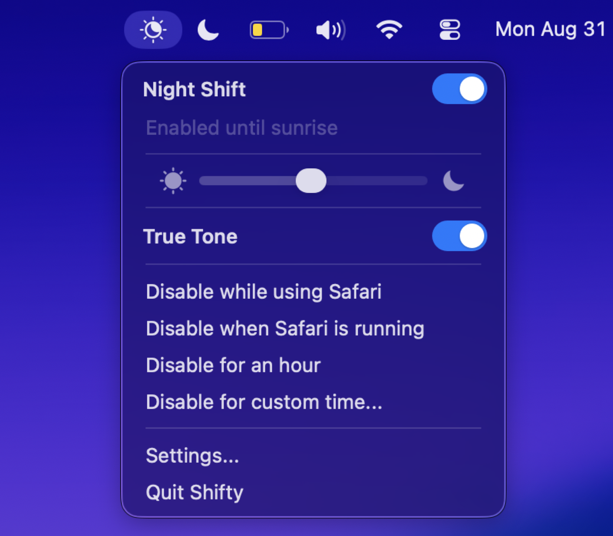
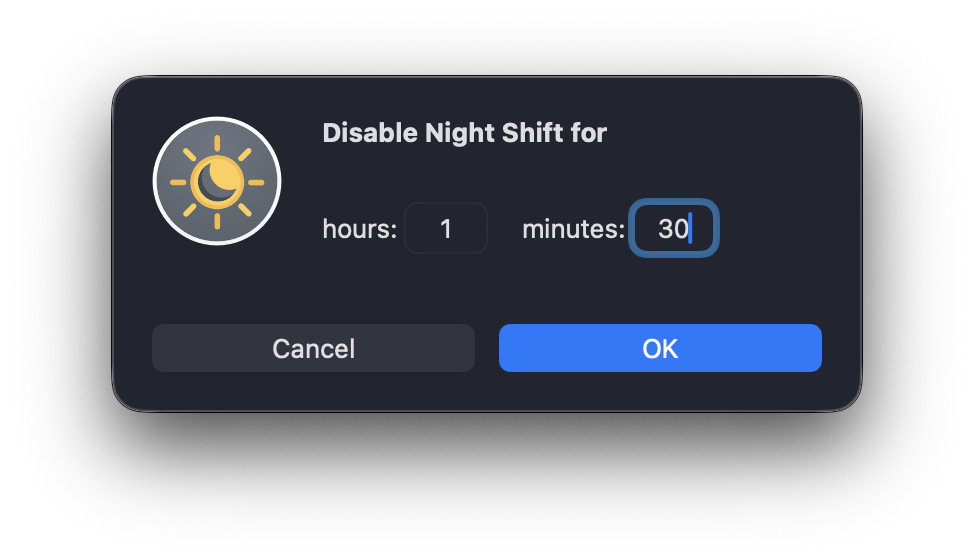

<p align="center"></p>

<h1 align="center">Shifty</h1>

<p align="center"><b>Night Shift, with the controls Apple left out.</b><br>
A menu bar app for macOS that turns Night Shift off for the apps and websites you choose.</p>

<p align="center"></p>

## Features

- 🪟 **Per-app rules.** Turn Night Shift off while you're using an app, or for as long as an app is
  running at all, even in the background.
- 🌐 **Per-site rules.** Turn it off for a domain or a single subdomain, in Safari, Chrome,
  Chromium, Edge, Brave, Opera or Vivaldi.
- ⏱️ **Timed pauses.** Turn it off for an hour, or for a duration you type in.
- 🌡️ **Colour temperature slider** in the menu, rather than buried in System Settings.
- 👆 **Quick Toggle.** Click the menu bar icon to switch Night Shift on or off, and right-click for
  the menu.
- 🗓️ **Schedule.** Sunset to sunrise, or custom hours, set from Shifty's settings.
- 🌗 **Transition speed.** Make Night Shift fade on and off faster or slower than macOS does.
- 🌙 **Dark Mode on the Night Shift schedule**, so the two change together.
- 🖥️ **True Tone control**, with your Night Shift rules applied to it as well.
- ⌨️ **Global keyboard shortcuts** for every action in the menu.

## Build from source

You need macOS 14 or later and Xcode 26 or later. Shifty is tested on macOS 27. The CocoaPods
dependencies are checked in, so there's nothing else to install.

```sh
git clone https://github.com/lorenzofanchi/Shifty.git
cd Shifty
Scripts/archive-and-install.sh
```

This archives a Release build into `build/archives`, installs it to `/Applications` and opens it.
You can also open `Shifty.xcworkspace` in Xcode and run the **Shifty** scheme. To sign with your own
Apple ID, pick your team under Signing & Capabilities.

There are no prebuilt downloads and no automatic updates.

Shifty needs a Mac that [supports Night Shift](https://support.apple.com/en-us/HT207513#requirements).
True Tone control needs a [Mac with True Tone](https://support.apple.com/HT208909).

## Usage

### The menu

Click the Shifty icon in the menu bar, or right-click it if Quick Toggle is on.

- **Night Shift** and **True Tone** switches, with the colour temperature slider under them.
- **Disable while using** the app you're in, or **Disable when** it's running at all.
- **Disable for** the website you're on: the whole domain, or just the subdomain. These appear when
  a supported browser is in front and Website Shifting is on.
- **Disable for an hour**, or **Disable for custom time** to type in how long.

<p align="center"></p>

### Settings

Choose **Settings…** in the menu.

- **General:** launch at login, Quick Toggle, Website Shifting, Scheduled Dark Mode and True Tone
  control.
- **Night Shift:** the schedule (Off, Custom or Sunset to Sunrise) and the transition speed (Slow,
  Normal, Fast or Very Fast).
- **Shortcuts:** record a global shortcut for any action in the menu. None are set by default.

### Permissions

Website Shifting needs two permissions, and macOS asks for each the first time it's needed:

- **Accessibility**, to notice when you switch windows or tabs.
- **Automation** for each browser, to read the address of the tab you're looking at.

If you said no, allow Shifty in System Settings → Privacy & Security.

## How it's built

- AppKit for the menu bar menu, SwiftUI for the Settings window
- Private CoreBrightness classes (`CBBlueLightClient`, `CBTrueToneClient`) to drive Night Shift
  and True Tone
- Scripting Bridge to read the browser's current address, and the Accessibility API
  ([AXSwift](https://github.com/tmandry/AXSwift)) to notice when it changes
- [MASShortcut](https://github.com/cocoabits/MASShortcut) for the global shortcuts

Night Shift and True Tone have no public API, so Shifty relies on private system frameworks. It
works today; a future version of macOS could break it.

## About this fork

Shifty was made by Nate Thompson, and this is a fork of
[thompsonate/Shifty](https://github.com/thompsonate/Shifty), maintained by Fruitful Development.
Upstream's last release was in 2021, and it no longer built with current versions of Xcode.

This fork brings it up to date. It builds with current Xcode, needs macOS 14, and drops
dependencies that stopped working: Microsoft App Center, which shut down in 2025, and Sparkle,
which pointed at upstream's update feed. It also adds a few things of its own, such as the
transition speed setting and a redesigned Settings window. Shifty is still Nate's design, and most
of the code is his.

To help translate Shifty, see [upstream's translation page](https://shifty.natethompson.io/translate).

## Support

If Shifty makes your evenings a little easier on the eyes, you can buy me a coffee:

<a href="https://ko-fi.com/fruitfuldevelopment"></a>

## License

GPLv3, as upstream, see [LICENSE](LICENSE). Contributions welcome.

© 2017-2021 Nate Thompson. Modifications © 2026 Fruitful Development.
